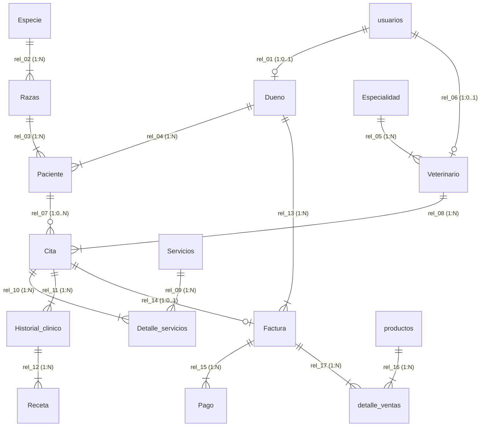

# Análisis Exhaustivo del Modelo Relacional de Datos (16 Tablas en 3FN)
**Proyecto:** Sistema Web Integral — Clínica Veterinaria *Patitas Felices*  
**Motor de Base de Datos:** SQLite 3 (`PRAGMA foreign_keys = ON`)  
**Archivos Fuente Sincronizados (100% Concordancia — 16 Tablas, 124 Columnas, 17 Relaciones):**
- Diagrama Entidad-Relación: [`database/prueba_1.erd.json`](file:///C:/Proyecto%20VS%20Code/Veterinaria/database/prueba_1.erd.json)
- Script DDL + DML SQLite: [`database/schema_sqlite.sql`](file:///C:/Proyecto%20VS%20Code/Veterinaria/database/schema_sqlite.sql)
- Base de Datos Física: [`database/patitas_felices.db`](file:///C:/Proyecto%20VS%20Code/Veterinaria/database/patitas_felices.db)
- Adaptador de Persistencia: [`SQLiteDatabaseAdapter`](file:///C:/Proyecto%20VS%20Code/Veterinaria/backend/patterns/adapter.py) y [`sqlite_schema.py`](file:///C:/Proyecto%20VS%20Code/Veterinaria/backend/patterns/sqlite_schema.py)

---

## 1. Justificación Arquitectónica y Normalización (1FN, 2FN y 3FN)

> [!IMPORTANT]
> El modelo de datos unificado consta exactamente de **16 entidades físicas**, **124 atributos tipados** y **17 relaciones de integridad referencial (`rel_01` a `rel_17`)**, eliminando por completo las 4 tablas paralelas antiguas (`mascotas`, `citas`, `ventas`, `solicitudes_mascota`) para garantizar una única fuente de verdad (*Single Source of Truth*).

- **Primera Forma Normal (1FN):** Todos los atributos son atómicos, sin grupos repetitivos. Los servicios aplicados a una cita se desacoplan en `Detalle_servicios`, y los productos comprados en una transacción se desacoplan en `detalle_ventas`.
- **Segunda Forma Normal (2FN):** Los atributos no clave dependen funcionalmente por completo de la clave primaria de su entidad (incluyendo la clave compuesta `(Id_cita, Id_servicios)` en `Detalle_servicios`).
- **Tercera Forma Normal (3FN):** Se eliminaron las dependencias transitivas mediante catálogos maestros normalizados:
  - La raza y especie de un paciente no dependen transitivamente de `Paciente`, sino de `Razas` → `Especie`.
  - La especialidad médica no se repite como texto libre en `Veterinario`, sino que referencia al catálogo `Especialidad`.
  - El catálogo de prestaciones médicas (`Servicios`) y el inventario comercial (`productos`) están separados de sus tablas transaccionales (`Detalle_servicios` y `detalle_ventas`).

---

## 2. Análisis Drástico de las 16 Entidades, 124 Atributos y 17 Relaciones

A continuación se detalla cada una de las **16 tablas** agrupadas por sus 4 dominios funcionales (codificados por color en [`database/prueba_1.erd.json`](file:///C:/Proyecto%20VS%20Code/Veterinaria/database/prueba_1.erd.json)), especificando su regla de validación del sistema y sus columnas exactas.

---

### DOMINIO I: Seguridad, Identidad y Propietarios (Verde `#2E7D32`)

#### Tabla 1: `usuarios` (10 atributos — Credenciales y Control de Acceso RBAC)
##### El sistema valida que cada cuenta de acceso posea un correo electrónico único, un rol autorizado (`cliente`, `doctor` o `admin`), una contraseña cifrada mediante `PBKDF2-HMAC-SHA256` y un estado `'activo'` antes de emitir tokens de sesión o permitir operaciones protegidas por los patrones `Proxy` y `Strategy`.

| # | Atributo | Tipo ERD / SQLite | Restricciones | Rol en la Entidad |
| :-: | :--- | :--- | :--- | :--- |
| 1 | `id` | `INTEGER` | `PK, AUTOINCREMENT` | Identificador único de la cuenta de usuario. |
| 2 | `nombre` | `VARCHAR(100)` / `TEXT` | `NOT NULL` | Nombre completo visible en la sesión y paneles. |
| 3 | `email` | `VARCHAR(120)` / `TEXT` | `NOT NULL, UNIQUE` | Correo electrónico único utilizado como credencial de login. |
| 4 | `password_hash` | `VARCHAR(255)` / `TEXT` | `NOT NULL` | Hash criptográfico `pbkdf2_sha256$...` con iteraciones y sal aleatoria. |
| 5 | `rol` | `VARCHAR(20)` / `TEXT` | `NOT NULL` | Rol de seguridad (`cliente`, `doctor`, `admin`) que determina la estrategia RBAC. |
| 6 | `estado` | `VARCHAR(20)` / `TEXT` | `NOT NULL DEFAULT 'activo'` | Estado de vigencia de la cuenta (`activo` / `inactivo`). |
| 7 | `telefono` | `VARCHAR(20)` / `TEXT` | `DEFAULT ''` | Teléfono de contacto asociado a la cuenta. |
| 8 | `tipo_documento` | `VARCHAR(15)` / `TEXT` | `DEFAULT 'DNI'` | Tipo de documento tributario o de identidad (`DNI`, `RUC`, `CE`). |
| 9 | `documento` | `VARCHAR(20)` / `TEXT` | `UNIQUE` | Número de documento único sincronizado con facturación y `Dueno`. |
| 10 | `creado_en` | `DATETIME` / `TEXT` | `NOT NULL DEFAULT CURRENT_TIMESTAMP` | Fecha y hora de creación de la cuenta. |

- **Relaciones:**
  - **Padre en `rel_01` (`1:0..1`):** `usuarios.id` → `Dueno.usuario_id`.
  - **Padre en `rel_06` (`1:0..1`):** `usuarios.id` → `Veterinario.usuario_id`.

---

#### Tabla 2: `Dueno` (9 atributos — Ficha Civil del Propietario / Cliente)
##### El sistema valida que todo usuario con rol `cliente` tenga asociada una única ficha civil de propietario con número de documento (`dni`) y correo únicos, sincronizando automáticamente sus datos personales cuando el cliente se registra, actualiza su perfil o realiza una compra en la tienda.

| # | Atributo | Tipo ERD / SQLite | Restricciones | Rol en la Entidad |
| :-: | :--- | :--- | :--- | :--- |
| 1 | `id_dueno` | `INTEGER` | `PK, AUTOINCREMENT` | Clave primaria del propietario en el modelo clínico y comercial. |
| 2 | `usuario_id` | `INTEGER` | `FK, UNIQUE REFERENCES usuarios(id)` | Clave foránea `1:0..1` hacia la cuenta de acceso en `usuarios`. |
| 3 | `dni` | `VARCHAR(20)` / `TEXT` | `NOT NULL, UNIQUE` | Documento Nacional de Identidad o RUC único del titular. |
| 4 | `tipo_documento` | `VARCHAR(15)` / `TEXT` | `NOT NULL DEFAULT 'DNI'` | Tipo de documento registrado (`DNI`, `RUC`, `CE`). |
| 5 | `correo` | `VARCHAR(120)` / `TEXT` | `NOT NULL, UNIQUE` | Correo electrónico único del propietario. |
| 6 | `nombres` | `VARCHAR(80)` / `TEXT` | `NOT NULL` | Nombres de pila del propietario. |
| 7 | `apellidos` | `VARCHAR(80)` / `TEXT` | `NOT NULL` | Apellidos del propietario. |
| 8 | `telefono` | `VARCHAR(20)` / `TEXT` | `NOT NULL` | Número telefónico principal para recordatorios y WhatsApp. |
| 9 | `fecha_registro` | `DATETIME` / `TEXT` | `NOT NULL DEFAULT CURRENT_TIMESTAMP` | Fecha y hora de alta del propietario en la clínica. |

- **Relaciones:**
  - **Hija en `rel_01` (`1:0..1`):** `Dueno.usuario_id` → `usuarios.id`.
  - **Padre en `rel_04` (`1:N`):** `Dueno.id_dueno` → `Paciente.id_dueno`.
  - **Padre en `rel_13` (`1:N`):** `Dueno.id_dueno` → `Factura.id_dueno`.

---

### DOMINIO II: Taxonomía Biológica y Pacientes (Azul `#0277BD`)

#### Tabla 3: `Especie` (3 atributos — Catálogo Taxonómico de Especies)
##### El sistema valida que cada especie animal (`Perro`, `Gato` o nuevas especies registradas desde el perfil del cliente) exista una sola vez en el catálogo maestro sin duplicidad de nombres antes de clasificar cualquier raza o paciente.

| # | Atributo | Tipo ERD / SQLite | Restricciones | Rol en la Entidad |
| :-: | :--- | :--- | :--- | :--- |
| 1 | `Id_especie` | `INTEGER` | `PK, AUTOINCREMENT` | Identificador único de la especie biológica. |
| 2 | `Nombre` | `VARCHAR(60)` / `TEXT` | `NOT NULL, UNIQUE` | Denominación única de la especie (`Perro`, `Gato`, etc.). |
| 3 | `Descripcion` | `TEXT` | `NOT NULL` | Descripción clínica general de la especie. |

- **Relaciones:**
  - **Padre en `rel_02` (`1:N`):** `Especie.Id_especie` → `Razas.Id_especie`.

---

#### Tabla 4: `Razas` (4 atributos — Catálogo Normalizado de Razas por Especie)
##### El sistema valida que toda raza pertenezca obligatoriamente a una `Especie` válida (`Id_especie`) con combinación única `(Id_especie, nombre)`, impidiendo que un paciente almacene texto desnormalizado sin vínculo taxonómico y garantizando la Tercera Forma Normal (3FN).

| # | Atributo | Tipo ERD / SQLite | Restricciones | Rol en la Entidad |
| :-: | :--- | :--- | :--- | :--- |
| 1 | `Id_raza` | `INTEGER` | `PK, AUTOINCREMENT` | Identificador único de la raza. |
| 2 | `Id_especie` | `INTEGER` | `FK, NOT NULL REFERENCES Especie(Id_especie)` | Clave foránea que asocia la raza con su especie madre. |
| 3 | `nombre` | `VARCHAR(80)` / `TEXT` | `NOT NULL` | Nombre de la raza (`Golden Retriever`, `Doméstico pelo corto`, `Mestizo`). |
| 4 | `Descripcion` | `TEXT` | `DEFAULT ''` | Características morfológicas o notas clínicas de la raza. |

- **Relaciones:**
  - **Hija en `rel_02` (`N:1`):** `Razas.Id_especie` → `Especie.Id_especie`.
  - **Padre en `rel_03` (`1:N`):** `Razas.Id_raza` → `Paciente.Id_raza`.

---

#### Tabla 5: `Paciente` (16 atributos — Expediente de la Mascota y Flujo de Solicitudes)
##### El sistema valida que cada mascota esté vinculada a un propietario (`id_dueno`) y a una raza (`Id_raza`), gestionando dentro de la misma entidad tanto su estado clínico (`Activo` / `Eliminado`) como el flujo auditable de solicitudes de modificación o baja (`solicitud_tipo`, `solicitud_estado`, `solicitud_motivo`, `solicitud_datos_nuevos`) que el administrador aprueba o rechaza.

| # | Atributo | Tipo ERD / SQLite | Restricciones | Rol en la Entidad |
| :-: | :--- | :--- | :--- | :--- |
| 1 | `id_paciente` | `INTEGER` | `PK, AUTOINCREMENT` | Identificador clínico único de la mascota. |
| 2 | `id_dueno` | `INTEGER` | `FK, NOT NULL REFERENCES Dueno(id_dueno)` | Clave foránea hacia el propietario titular. |
| 3 | `Id_raza` | `INTEGER` | `FK, NOT NULL REFERENCES Razas(Id_raza)` | Clave foránea hacia la raza (y transitivamente su especie). |
| 4 | `nombre` | `VARCHAR(60)` / `TEXT` | `NOT NULL` | Nombre de la mascota. |
| 5 | `sexo` | `CHAR(1)` / `TEXT` | `NOT NULL DEFAULT 'H'` | Sexo biológico del paciente (`M` = Macho, `H` = Hembra). |
| 6 | `fecha_nacimiento` | `DATE` / `TEXT` | `NOT NULL` | Fecha estimada o exacta de nacimiento (`YYYY-MM-DD`). |
| 7 | `edad` | `INTEGER` | `NOT NULL DEFAULT 1` | Edad registrada en años. |
| 8 | `peso_kg` | `DECIMAL(5,2)` / `REAL` | `NOT NULL DEFAULT 5.0` | Peso corporal en kilogramos para dosificación médica. |
| 9 | `historial_resumen` | `TEXT` | `DEFAULT ''` | Antecedentes clínicos, alergias y vacunas registradas. |
| 10 | `estado` | `VARCHAR(25)` / `TEXT` | `NOT NULL DEFAULT 'Activo'` | Estado de vigencia del expediente (`Activo` / `Eliminado`). |
| 11 | `fecha_registro` | `DATETIME` / `TEXT` | `NOT NULL DEFAULT CURRENT_TIMESTAMP` | Fecha y hora de inscripción en el sistema. |
| 12 | `solicitud_tipo` | `VARCHAR(30)` / `TEXT` | `NULL` | Tipo de solicitud enviada por el cliente (`modificar` o `eliminar`). |
| 13 | `solicitud_datos_nuevos` | `TEXT` | `NULL` | JSON serializado con los cambios propuestos por el propietario. |
| 14 | `solicitud_motivo` | `TEXT` | `NULL` | Justificación ingresada por el cliente para la solicitud. |
| 15 | `solicitud_estado` | `VARCHAR(25)` / `TEXT` | `NULL` | Estado de la solicitud (`pendiente`, `aprobada`, `rechazada`). |
| 16 | `solicitud_creado_en` | `DATETIME` / `TEXT` | `NULL` | Marca temporal de creación de la solicitud. |

- **Relaciones:**
  - **Hija en `rel_03` (`N:1`):** `Paciente.Id_raza` → `Razas.Id_raza`.
  - **Hija en `rel_04` (`N:1`):** `Paciente.id_dueno` → `Dueno.id_dueno`.
  - **Padre en `rel_07` (`1:0..N`):** `Paciente.id_paciente` → `Cita.id_paciente`.

---

### DOMINIO III: Cuerpo Médico, Agendamiento y Atención Clínica (Púrpura `#6A1B9A`)

#### Tabla 6: `Especialidad` (3 atributos — Catálogo de Especialidades Veterinarias)
##### El sistema valida que cada área de especialización médica (`Medicina General`, `Dermatología y Alergia`, `Cirugía`, etc.) esté tipificada como entidad maestra única antes de habilitar el alta de médicos veterinarios.

| # | Atributo | Tipo ERD / SQLite | Restricciones | Rol en la Entidad |
| :-: | :--- | :--- | :--- | :--- |
| 1 | `Id_especialidad` | `INTEGER` | `PK, AUTOINCREMENT` | Identificador único de la especialidad médica. |
| 2 | `Nombre` | `VARCHAR(80)` / `TEXT` | `NOT NULL, UNIQUE` | Nombre oficial único de la especialidad veterinaria. |
| 3 | `Descripcion` | `TEXT` | `NOT NULL` | Alcance clínico y competencias de la especialidad. |

- **Relaciones:**
  - **Padre en `rel_05` (`1:N`):** `Especialidad.Id_especialidad` → `Veterinario.Id_especialidad`.

---

#### Tabla 7: `Veterinario` (9 atributos — Personal Médico Colegiado)
##### El sistema valida que cada doctor registrado desde el panel administrativo posea una especialidad válida (`Id_especialidad`), un código de colegiatura único (`numero_colegiatura`) y un vínculo directo con su cuenta de usuario (`usuario_id`) para atender citas en su panel clínico.

| # | Atributo | Tipo ERD / SQLite | Restricciones | Rol en la Entidad |
| :-: | :--- | :--- | :--- | :--- |
| 1 | `Id_veterinario` | `INTEGER` | `PK, AUTOINCREMENT` | Identificador único del médico veterinario. |
| 2 | `usuario_id` | `INTEGER` | `FK, UNIQUE REFERENCES usuarios(id)` | Clave foránea `1:0..1` hacia la cuenta con rol `doctor` en `usuarios`. |
| 3 | `Id_especialidad` | `INTEGER` | `FK, NOT NULL REFERENCES Especialidad(Id_especialidad)` | Clave foránea hacia su especialidad médica. |
| 4 | `numero_colegiatura` | `VARCHAR(30)` / `TEXT` | `NOT NULL, UNIQUE` | Código único del Colegio Médico Veterinario del Perú (`CMVP`). |
| 5 | `nombres` | `VARCHAR(80)` / `TEXT` | `NOT NULL` | Nombres del profesional veterinario. |
| 6 | `Apellidos` | `VARCHAR(80)` / `TEXT` | `NOT NULL` | Apellidos del profesional veterinario. |
| 7 | `Telefono` | `VARCHAR(20)` / `TEXT` | `NOT NULL` | Teléfono profesional de contacto. |
| 8 | `correo` | `VARCHAR(120)` / `TEXT` | `NOT NULL, UNIQUE` | Correo institucional único del médico. |
| 9 | `Fecha_contratacion` | `DATE` / `TEXT` | `NOT NULL DEFAULT CURRENT_DATE` | Fecha de incorporación a la clínica. |

- **Relaciones:**
  - **Hija en `rel_05` (`N:1`):** `Veterinario.Id_especialidad` → `Especialidad.Id_especialidad`.
  - **Hija en `rel_06` (`1:0..1`):** `Veterinario.usuario_id` → `usuarios.id`.
  - **Padre en `rel_08` (`1:N`):** `Veterinario.Id_veterinario` → `Cita.Id_veterinario`.

---

#### Tabla 8: `Servicios` (4 atributos — Catálogo Tarifario de Prestaciones Clínicas)
##### El sistema valida que todo servicio médico ofrecido en el formulario de reserva (`Consulta general`, `Vacunación`, `Desparasitación`, `Control y seguimiento`) tenga nombre único, precio positivo y estado activo para liquidar con exactitud los cargos de cada cita.

| # | Atributo | Tipo ERD / SQLite | Restricciones | Rol en la Entidad |
| :-: | :--- | :--- | :--- | :--- |
| 1 | `Id_servicios` | `INTEGER` | `PK, AUTOINCREMENT` | Identificador único de la prestación médica. |
| 2 | `Nombre` | `VARCHAR(80)` / `TEXT` | `NOT NULL, UNIQUE` | Nombre comercial único de la prestación médica. |
| 3 | `Precio` | `DECIMAL(10,2)` / `REAL` | `NOT NULL` | Tarifa unitaria vigente en soles (`S/`). |
| 4 | `Estado` | `VARCHAR(20)` / `TEXT` | `NOT NULL DEFAULT 'Activo'` | Estado de disponibilidad en el catálogo (`Activo` / `Inactivo`). |

- **Relaciones:**
  - **Padre en `rel_09` (`1:N`):** `Servicios.Id_servicios` → `Detalle_servicios.Id_servicios`.

---

#### Tabla 9: `Cita` (13 atributos — Agendamiento y Control de Cupos por Turno)
##### El sistema valida que en una misma fecha y bloque horario (`08:30`, `10:00`, `11:30`, `13:00`, `15:30`, `17:00`, `18:30`) no se superen los **3 cupos médicos máximos** (3 doctores en turno), verificando además que la mascota pertenezca al usuario autenticado y generando el enlace de confirmación por WhatsApp mediante `WhatsAppAdapter`.

| # | Atributo | Tipo ERD / SQLite | Restricciones | Rol en la Entidad |
| :-: | :--- | :--- | :--- | :--- |
| 1 | `Id_cita` | `INTEGER` | `PK, AUTOINCREMENT` | Identificador único de la cita programada. |
| 2 | `Id_veterinario` | `INTEGER` | `FK, NOT NULL REFERENCES Veterinario(Id_veterinario)` | Médico veterinario asignado a la atención. |
| 3 | `id_paciente` | `INTEGER` | `FK, REFERENCES Paciente(id_paciente)` | Mascota vinculada (opcional en reservas rápidas públicas). |
| 4 | `fecha` | `DATE` / `TEXT` | `NOT NULL` | Fecha programada de la cita (`YYYY-MM-DD`). |
| 5 | `hora` | `TIME` / `TEXT` | `NOT NULL` | Bloque horario seleccionado (`HH:MM`). |
| 6 | `motivo` | `TEXT` | `NOT NULL` | Síntomas o razón de consulta descrita por el propietario. |
| 7 | `estado` | `VARCHAR(25)` / `TEXT` | `NOT NULL DEFAULT 'pendiente'` | Estado del flujo clínico (`pendiente`, `confirmada`, `atendida`, `cancelada`). |
| 8 | `propietario` | `VARCHAR(100)` / `TEXT` | `NOT NULL DEFAULT ''` | Nombre del propietario consignado en la reserva. |
| 9 | `telefono` | `VARCHAR(20)` / `TEXT` | `NOT NULL DEFAULT ''` | Teléfono de contacto directo para el recordatorio por WhatsApp. |
| 10 | `mascota_nombre` | `VARCHAR(60)` / `TEXT` | `NOT NULL DEFAULT ''` | Nombre de la mascota consignado en la reserva. |
| 11 | `servicio` | `VARCHAR(60)` / `TEXT` | `NOT NULL DEFAULT 'consulta-general'` | Clave del servicio solicitado (`consulta-general`, `vacunacion`, etc.). |
| 12 | `whatsapp_url` | `TEXT` | `NOT NULL DEFAULT ''` | Enlace `https://wa.me/...` generado por el patrón `Adapter`. |
| 13 | `fecha_registro` | `DATETIME` / `TEXT` | `NOT NULL DEFAULT CURRENT_TIMESTAMP` | Marca temporal exacta de creación de la reserva. |

- **Relaciones:**
  - **Hija en `rel_07` (`0..N:1`):** `Cita.id_paciente` → `Paciente.id_paciente`.
  - **Hija en `rel_08` (`N:1`):** `Cita.Id_veterinario` → `Veterinario.Id_veterinario`.
  - **Padre en `rel_10` (`1:N`):** `Cita.Id_cita` → `Detalle_servicios.Id_cita`.
  - **Padre en `rel_11` (`1:N`):** `Cita.Id_cita` → `Historial_clinico.Id_cita`.
  - **Padre en `rel_14` (`1:0..1`):** `Cita.Id_cita` → `Factura.Id_cita`.

---

#### Tabla 10: `Detalle_servicios` (3 atributos — Entidad Asociativa `Cita` ↔ `Servicios`)
##### El sistema valida mediante clave primaria compuesta `(Id_cita, Id_servicios)` que cada cita agendada registre en esta tabla puente el servicio contratado junto con su `precio_aplicado` histórico, resolviendo la relación muchos-a-muchos entre `Cita` y `Servicios` en 3FN.

| # | Atributo | Tipo ERD / SQLite | Restricciones | Rol en la Entidad |
| :-: | :--- | :--- | :--- | :--- |
| 1 | `Id_cita` | `INTEGER` | `PK, FK REFERENCES Cita(Id_cita)` | Clave foránea hacia la cita médica (parte de la PK compuesta). |
| 2 | `Id_servicios` | `INTEGER` | `PK, FK REFERENCES Servicios(Id_servicios)` | Clave foránea hacia el catálogo de servicios (parte de la PK compuesta). |
| 3 | `precio_aplicado` | `DECIMAL(10,2)` / `REAL` | `NOT NULL DEFAULT 0` | Precio unitario congelado en el momento de la atención. |

- **Relaciones:**
  - **Hija en `rel_09` (`N:1`):** `Detalle_servicios.Id_servicios` → `Servicios.Id_servicios`.
  - **Hija en `rel_10` (`N:1`):** `Detalle_servicios.Id_cita` → `Cita.Id_cita`.

---

#### Tabla 11: `Historial_clinico` (6 atributos — Acto Médico y Diagnóstico)
##### El sistema valida que cuando un usuario con rol `doctor` actualiza o culmina una cita médica en su panel clínico, el diagnóstico, tratamiento y observaciones se persistan de forma estructurada en `Historial_clinico` vinculados a `Id_cita`.

| # | Atributo | Tipo ERD / SQLite | Restricciones | Rol en la Entidad |
| :-: | :--- | :--- | :--- | :--- |
| 1 | `Id_historial` | `INTEGER` | `PK, AUTOINCREMENT` | Identificador único del episodio clínico. |
| 2 | `Id_cita` | `INTEGER` | `FK, NOT NULL REFERENCES Cita(Id_cita)` | Clave foránea hacia la cita médica que originó la atención. |
| 3 | `Fecha` | `DATE` / `TEXT` | `NOT NULL DEFAULT CURRENT_DATE` | Fecha del acto médico. |
| 4 | `Diagnostico` | `TEXT` | `NOT NULL DEFAULT ''` | Juicio clínico emitido por el médico veterinario. |
| 5 | `Tratamiento` | `TEXT` | `NOT NULL DEFAULT ''` | Procedimiento terapéutico indicado por el doctor. |
| 6 | `Observaciones` | `TEXT` | `NOT NULL DEFAULT ''` | Notas adicionales de seguimiento clínico. |

- **Relaciones:**
  - **Hija en `rel_11` (`N:1`):** `Historial_clinico.Id_cita` → `Cita.Id_cita`.
  - **Padre en `rel_12` (`1:N`):** `Historial_clinico.Id_historial` → `Receta.Id_historial`.

---

#### Tabla 12: `Receta` (6 atributos — Prescripción Farmacológica)
##### El sistema valida que toda prescripción de medicamentos (`medicamento`, `Dosis`, `duracion_dias` e `indicaciones`) dependa obligatoriamente de un acto médico registrado en `Historial_clinico` (`Id_historial`), impidiendo recetas huérfanas sin diagnóstico previo.

| # | Atributo | Tipo ERD / SQLite | Restricciones | Rol en la Entidad |
| :-: | :--- | :--- | :--- | :--- |
| 1 | `Id_receta` | `INTEGER` | `PK, AUTOINCREMENT` | Identificador único de la receta médica. |
| 2 | `Id_historial` | `INTEGER` | `FK, NOT NULL REFERENCES Historial_clinico(Id_historial)` | Clave foránea hacia la evaluación clínica que respalda la receta. |
| 3 | `medicamento` | `VARCHAR(120)` / `TEXT` | `NOT NULL` | Principio activo o nombre comercial del fármaco prescrito. |
| 4 | `Dosis` | `VARCHAR(80)` / `TEXT` | `NOT NULL` | Posología exacta según el peso del paciente. |
| 5 | `duracion_dias` | `INTEGER` | `NOT NULL DEFAULT 1` | Duración total del tratamiento en días. |
| 6 | `indicaciones` | `TEXT` | `NOT NULL DEFAULT ''` | Recomendaciones de administración para el propietario. |

- **Relaciones:**
  - **Hija en `rel_12` (`N:1`):** `Receta.Id_historial` → `Historial_clinico.Id_historial`.

---

### DOMINIO IV: E-Commerce Veterinario, Facturación Tributaria y Tesorería (Ámbar `#EF6C00`)

#### Tabla 13: `Factura` (16 atributos — Cabecera de Comprobantes Electrónicos)
##### El sistema valida mediante `SubsistemaCRMTransacciones` (del patrón `Facade`) el cálculo tributario exacto de la Boleta/Factura peruana ($\text{Subtotal} = \text{Total} / 1.18$, $\text{IGV} = 18\%$, $\text{Total}$), la unicidad del correlativo (`serie` + `numero`, ej. `B001-000001` o `F001-000001`) y su vinculación con el titular (`id_dueno`) y opcionalmente con una cita clínica (`Id_cita`).

| # | Atributo | Tipo ERD / SQLite | Restricciones | Rol en la Entidad |
| :-: | :--- | :--- | :--- | :--- |
| 1 | `id_factura` | `INTEGER` | `PK, AUTOINCREMENT` | Identificador único del comprobante electrónico. |
| 2 | `Id_cita` | `INTEGER` | `FK, UNIQUE REFERENCES Cita(Id_cita)` | Clave foránea opcional (`0..1`) si la factura liquida una cita clínica. |
| 3 | `id_dueno` | `INTEGER` | `FK REFERENCES Dueno(id_dueno)` | Clave foránea hacia el cliente titular del comprobante. |
| 4 | `tipo` | `VARCHAR(20)` / `TEXT` | `NOT NULL DEFAULT 'Boleta'` | Tipo de comprobante SUNAT (`Boleta` o `Factura`). |
| 5 | `serie` | `VARCHAR(10)` / `TEXT` | `NOT NULL DEFAULT 'B001'` | Serie electrónica (`B001` para tienda/boletas, `F001` para facturas). |
| 6 | `numero` | `INTEGER` | `NOT NULL` | Correlativo numérico secuencial dentro de la serie. |
| 7 | `numero_boleta` | `VARCHAR(30)` / `TEXT` | `NOT NULL, UNIQUE` | Código formateado completo (`B001-000001`) impreso en el PDF. |
| 8 | `fecha_emision` | `DATETIME` / `TEXT` | `NOT NULL DEFAULT CURRENT_TIMESTAMP` | Fecha y hora de emisión del comprobante. |
| 9 | `cliente_nombre` | `VARCHAR(120)` / `TEXT` | `NOT NULL` | Razón social o nombre completo consignado en el comprobante. |
| 10 | `cliente_documento` | `VARCHAR(20)` / `TEXT` | `NOT NULL` | DNI o RUC validado del adquirente. |
| 11 | `subtotal` | `DECIMAL(10,2)` / `REAL` | `NOT NULL` | Base imponible (Valor Venta sin IGV). |
| 12 | `igv` | `DECIMAL(10,2)` / `REAL` | `NOT NULL` | Impuesto General a las Ventas calculado al $18\%$. |
| 13 | `total` | `DECIMAL(12,2)` / `REAL` | `NOT NULL` | Importe total pagado ($\text{Subtotal} + \text{IGV}$). |
| 14 | `metodo_pago` | `VARCHAR(40)` / `TEXT` | `NOT NULL DEFAULT 'Tarjeta / Yape'` | Medio de pago utilizado en el checkout. |
| 15 | `estado` | `VARCHAR(25)` / `TEXT` | `NOT NULL DEFAULT 'Pagado'` | Estado contable (`Pagado`, `Pendiente`, `Anulado`). |
| 16 | `pdf_url` | `TEXT` | `NULL` | Referencia opcional al documento PDF generado. |

- **Relaciones:**
  - **Hija en `rel_13` (`N:1`):** `Factura.id_dueno` → `Dueno.id_dueno`.
  - **Hija en `rel_14` (`0..1:1`):** `Factura.Id_cita` → `Cita.Id_cita`.
  - **Padre en `rel_15` (`1:N`):** `Factura.id_factura` → `Pago.id_factura`.
  - **Padre en `rel_17` (`1:N`):** `Factura.id_factura` → `detalle_ventas.id_factura`.

---

#### Tabla 14: `Pago` (7 atributos — Movimientos de Caja y Conciliación de Cobros)
##### El sistema valida que toda emisión de `Factura` genere su respectivo movimiento de tesorería en la tabla `Pago` con el monto abonado, el medio de pago (`Yape`, `Plin`, `Tarjeta`, `Efectivo`) y la referencia de operación.

| # | Atributo | Tipo ERD / SQLite | Restricciones | Rol en la Entidad |
| :-: | :--- | :--- | :--- | :--- |
| 1 | `id_pago` | `INTEGER` | `PK, AUTOINCREMENT` | Identificador único del movimiento de pago. |
| 2 | `id_factura` | `INTEGER` | `FK, NOT NULL REFERENCES Factura(id_factura)` | Clave foránea hacia el comprobante que se está cancelando. |
| 3 | `metodo_pago` | `VARCHAR(40)` / `TEXT` | `NOT NULL` | Canal de pago (`Yape`, `Plin`, `Tarjeta`, `Efectivo`). |
| 4 | `monto` | `DECIMAL(12,2)` / `REAL` | `NOT NULL` | Importe abonado en soles (`S/`). |
| 5 | `estado` | `VARCHAR(25)` / `TEXT` | `NOT NULL DEFAULT 'Pagado'` | Estado de confirmación del abono (`Pagado`, `Pendiente`). |
| 6 | `fecha_pago` | `DATETIME` / `TEXT` | `NOT NULL DEFAULT CURRENT_TIMESTAMP` | Marca temporal exacta del abono en caja o pasarela. |
| 7 | `referencia` | `VARCHAR(80)` / `TEXT` | `NULL` | Código de operación bancaria o billetera digital. |

- **Relaciones:**
  - **Hija en `rel_15` (`N:1`):** `Pago.id_factura` → `Factura.id_factura`.

---

#### Tabla 15: `productos` (8 atributos — Catálogo de Inventario de la Tienda Veterinaria)
##### El sistema valida mediante `SubsistemaInventario` (dentro del patrón `Facade`) que todo producto solicitado en el carrito exista, se encuentre activo (`activo = 1`) y cuente con `stock >= cantidad` suficiente antes de autorizar el descuento atómico de unidades y emitir el comprobante.

| # | Atributo | Tipo ERD / SQLite | Restricciones | Rol en la Entidad |
| :-: | :--- | :--- | :--- | :--- |
| 1 | `id` | `INTEGER` | `PK, AUTOINCREMENT` | Identificador único del producto o insumo veterinario. |
| 2 | `codigo` | `VARCHAR(20)` / `TEXT` | `NOT NULL, UNIQUE` | SKU único del producto (`PF-001` a `PF-006`). |
| 3 | `nombre` | `VARCHAR(120)` / `TEXT` | `NOT NULL` | Nombre comercial del producto en el catálogo web. |
| 4 | `categoria` | `VARCHAR(50)` / `TEXT` | `NOT NULL` | Categoría comercial (`Farmacia`, `Higiene`, `Accesorios`, `Alimentos`). |
| 5 | `descripcion` | `TEXT` | `NOT NULL` | Especificaciones técnicas y beneficios del producto. |
| 6 | `precio` | `DECIMAL(10,2)` / `REAL` | `NOT NULL` | Precio unitario de venta al público (incluye IGV) en soles (`S/`). |
| 7 | `stock` | `INTEGER` | `NOT NULL DEFAULT 0` | Existencias disponibles en almacén en tiempo real. |
| 8 | `activo` | `INTEGER` | `NOT NULL DEFAULT 1` | Disponibilidad comercial (`1` = visible en tienda, `0` = oculto). |

- **Relaciones:**
  - **Padre en `rel_16` (`1:N`):** `productos.id` → `detalle_ventas.producto_id`.

---

#### Tabla 16: `detalle_ventas` (7 atributos — Líneas de Productos por Comprobante)
##### El sistema valida que cada ítem comprado en la tienda se persista referenciando tanto al comprobante (`id_factura`) como al producto del catálogo (`producto_id`), conservando el `precio_unitario` y el `subtotal` exactos vigentes en el instante de la compra para auditoría del CRM financiero.

| # | Atributo | Tipo ERD / SQLite | Restricciones | Rol en la Entidad |
| :-: | :--- | :--- | :--- | :--- |
| 1 | `id` | `INTEGER` | `PK, AUTOINCREMENT` | Identificador único de la línea de detalle de venta. |
| 2 | `id_factura` | `INTEGER` | `FK, NOT NULL REFERENCES Factura(id_factura)` | Clave foránea hacia el comprobante electrónico padre. |
| 3 | `producto_id` | `INTEGER` | `FK, NOT NULL REFERENCES productos(id)` | Clave foránea hacia el producto descontado de inventario. |
| 4 | `producto_nombre` | `VARCHAR(120)` / `TEXT` | `NOT NULL` | Descripción comercial congelada para el PDF de la boleta. |
| 5 | `cantidad` | `INTEGER` | `NOT NULL` | Unidades adquiridas de dicho producto. |
| 6 | `precio_unitario` | `DECIMAL(10,2)` / `REAL` | `NOT NULL` | Precio unitario aplicado en la transacción. |
| 7 | `subtotal` | `DECIMAL(12,2)` / `REAL` | `NOT NULL` | Importe de la línea ($\text{cantidad} \times \text{precio\_unitario}$). |

- **Relaciones:**
  - **Hija en `rel_16` (`N:1`):** `detalle_ventas.producto_id` → `productos.id`.
  - **Hija en `rel_17` (`N:1`):** `detalle_ventas.id_factura` → `Factura.id_factura`.

---

## 3. Matriz Completa de las 17 Relaciones de Integridad Referencial (`rel_01` a `rel_17`)

| ID en ERD | Tabla Padre (1) | Clave Primaria (PK) | Tabla Hija (N) | Clave Foránea (FK) | Cardinalidad | Regla de Integridad que el Sistema Valida |
| :---: | :--- | :--- | :--- | :--- | :---: | :--- |
| **`rel_01`** | `usuarios` | `id` | `Dueno` | `usuario_id` | `1 : 0..1` | Vincula la cuenta de login del cliente con su ficha civil de propietario (`UNIQUE`). |
| **`rel_02`** | `Especie` | `Id_especie` | `Razas` | `Id_especie` | `1 : 1..N` | Clasifica cada raza dentro de su especie biológica correspondiente. |
| **`rel_03`** | `Razas` | `Id_raza` | `Paciente` | `Id_raza` | `1 : 1..N` | Tipifica la raza del paciente y permite deducir su especie en 3FN. |
| **`rel_04`** | `Dueno` | `id_dueno` | `Paciente` | `id_dueno` | `1 : 1..N` | Asigna la titularidad legal y clínica de una o más mascotas a un propietario. |
| **`rel_05`** | `Especialidad` | `Id_especialidad` | `Veterinario` | `Id_especialidad` | `1 : 1..N` | Asigna el área de especialización médica a cada veterinario. |
| **`rel_06`** | `usuarios` | `id` | `Veterinario` | `usuario_id` | `1 : 0..1` | Vincula la cuenta de login con rol `doctor` con su registro médico colegiado (`UNIQUE`). |
| **`rel_07`** | `Paciente` | `id_paciente` | `Cita` | `id_paciente` | `1 : 0..N` | Asocia la cita médica con el expediente de la mascota atendida. |
| **`rel_08`** | `Veterinario` | `Id_veterinario` | `Cita` | `Id_veterinario` | `1 : 1..N` | Asigna el médico responsable de atender cada cita programada. |
| **`rel_09`** | `Servicios` | `Id_servicios` | `Detalle_servicios` | `Id_servicios` | `1 : 1..N` | Referencia el servicio oficial del tarifario aplicado en la cita. |
| **`rel_10`** | `Cita` | `Id_cita` | `Detalle_servicios` | `Id_cita` | `1 : 1..N` | Desglosa las prestaciones médicas realizadas dentro de una cita. |
| **`rel_11`** | `Cita` | `Id_cita` | `Historial_clinico` | `Id_cita` | `1 : 1..N` | Registra la evaluación médica, diagnóstico y tratamiento de la cita. |
| **`rel_12`** | `Historial_clinico` | `Id_historial` | `Receta` | `Id_historial` | `1 : 1..N` | Emite los fármacos e indicaciones derivados de un diagnóstico clínico. |
| **`rel_13`** | `Dueno` | `id_dueno` | `Factura` | `id_dueno` | `1 : 1..N` | Registra al propietario como receptor tributario de la boleta o factura. |
| **`rel_14`** | `Cita` | `Id_cita` | `Factura` | `Id_cita` | `1 : 0..1` | Permite asociar opcionalmente una factura a la liquidación de una cita médica (`UNIQUE`). |
| **`rel_15`** | `Factura` | `id_factura` | `Pago` | `id_factura` | `1 : 1..N` | Registra los cobros y abonos que cancelan el importe de una factura. |
| **`rel_16`** | `productos` | `id` | `detalle_ventas` | `producto_id` | `1 : 1..N` | Conecta el ítem vendido con el catálogo de inventario para control de stock. |
| **`rel_17`** | `Factura` | `id_factura` | `detalle_ventas` | `id_factura` | `1 : 1..N` | Vincula cada línea de producto vendido con su boleta/factura electrónica. |
