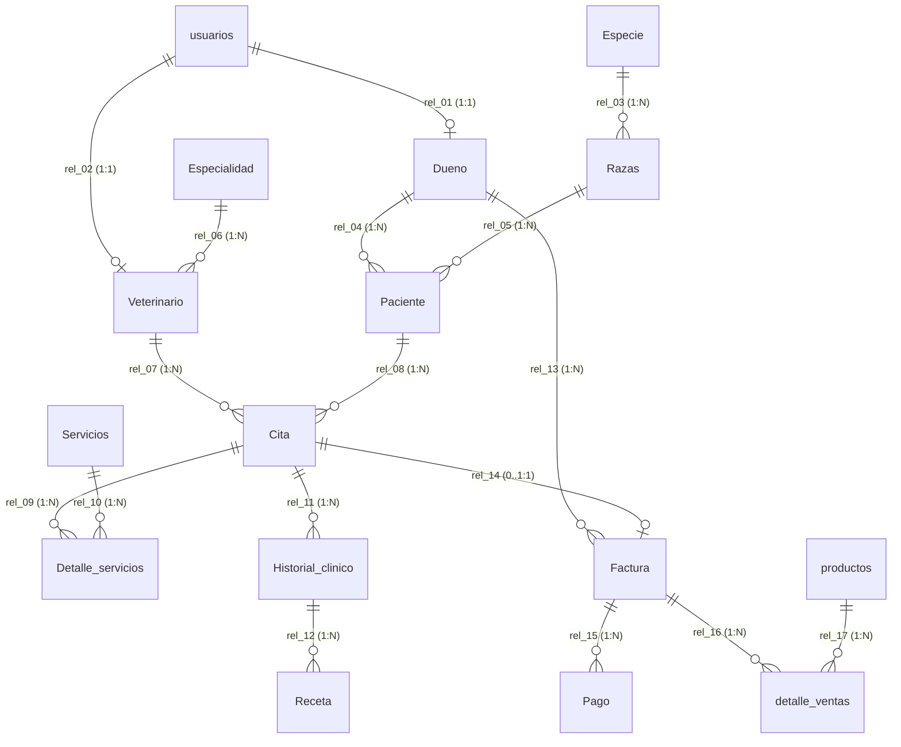

# Análisis Exhaustivo del Modelo Relacional de Datos (16 Tablas en 3FN)
**Proyecto:** Sistema Web Integral — Clínica Veterinaria *Patitas Felices*  
**Motor de Base de Datos:** SQLite 3 (`PRAGMA foreign_keys = ON`)  
**Archivos Fuente Sincronizados:**
- Diagrama Entidad-Relación: [`database/prueba_1.erd.json`](file:///C:/Proyecto%20VS%20Code/Veterinaria/database/prueba_1.erd.json)
- Script DDL + DML SQLite: [`database/schema_sqlite.sql`](file:///C:/Proyecto%20VS%20Code/Veterinaria/database/schema_sqlite.sql)
- Base de Datos Física: [`database/patitas_felices.db`](file:///C:/Proyecto%20VS%20Code/Veterinaria/database/patitas_felices.db)
- Adaptador de Persistencia: [`SQLiteDatabaseAdapter`](file:///C:/Proyecto%20VS%20Code/Veterinaria/backend/patterns/adapter.py) y [`sqlite_schema.py`](file:///C:/Proyecto%20VS%20Code/Veterinaria/backend/patterns/sqlite_schema.py)

---

## 1. Justificación Arquitectónica y Normalización (1FN, 2FN y 3FN)

> [!IMPORTANT]
> El modelo de datos unificado consta exactamente de **16 entidades físicas**, **124 atributos tipados** y **17 relaciones de integridad referencial (`rel_01` a `rel_17`)**, eliminando por completo las 4 tablas paralelas antiguas (`mascotas`, `citas`, `ventas`, `solicitudes_mascota`) para garantizar una única fuente de verdad (Single Source of Truth).

- **Primera Forma Normal (1FN):** Todos los atributos son atómicos, sin grupos repetitivos ni arreglos embebidos. Los servicios aplicados a una cita se desacoplan en `Detalle_servicios`, y los productos comprados en una transacción se desacoplan en `detalle_ventas`.
- **Segunda Forma Normal (2FN):** Todas las tablas poseen claves primarias (`PRIMARY KEY`) simples y los atributos no clave dependen funcionalmente por completo de la clave primaria de su entidad.
- **Tercera Forma Normal (3FN):** Se eliminaron las dependencias transitivas mediante catálogos maestros normalizados:
  - La raza y especie de un paciente no dependen transitivamente de `Paciente`, sino de `Razas` → `Especie`.
  - La especialidad médica no se repite como texto libre en `Veterinario`, sino que referencia al catálogo `Especialidad`.
  - El catálogo de prestaciones médicas (`Servicios`) y el inventario comercial (`productos`) están separados de sus tablas transaccionales (`Detalle_servicios` y `detalle_ventas`).

---

## 2. Análisis Drástico de las 16 Entidades, Atributos y Relaciones

A continuación se detalla cada una de las **16 tablas** agrupadas por sus 4 dominios funcionales, especificando su regla de validación del sistema, estructura de atributos y relaciones de clave foránea.

---

### DOMINIO I: Seguridad, Identidad y Propietarios

#### Tabla 1: `usuarios` (Credenciales y Control de Acceso RBAC)
##### El sistema valida que cada cuenta de acceso posea un correo electrónico único, un rol autorizado (`cliente`, `doctor` o `admin`), una contraseña cifrada mediante `PBKDF2-HMAC-SHA256` y un estado activo (`activo = 1`) antes de emitir tokens de sesión o permitir operaciones protegidas por el patrón `Proxy` y `Strategy`.

| Atributo | Tipo SQLite | Restricciones | Rol en la Entidad |
| :--- | :--- | :--- | :--- |
| `id` | `INTEGER` | `PRIMARY KEY AUTOINCREMENT` | Identificador único de la cuenta de usuario. |
| `nombre` | `TEXT` | `NOT NULL` | Nombre completo visible en la sesión y paneles. |
| `email` | `TEXT` | `NOT NULL UNIQUE` | Correo electrónico único utilizado como credencial de login. |
| `password_hash` | `TEXT` | `NOT NULL` | Hash criptográfico `pbkdf2_sha256$...` con iteraciones y sal aleatoria. |
| `rol` | `TEXT` | `NOT NULL CHECK(rol IN ('cliente','doctor','admin'))` | Rol de seguridad que determina la estrategia RBAC. |
| `telefono` | `TEXT` | `DEFAULT ''` | Teléfono de contacto asociado a la cuenta. |
| `documento` | `TEXT` | `DEFAULT ''` | Documento de identidad (DNI / RUC / CE) sincronizado con facturación. |
| `activo` | `INTEGER` | `NOT NULL DEFAULT 1` | Indicador lógico de vigencia (`1` = habilitado, `0` = bloqueado/baja). |

- **Relaciones salientes/entrantes:**
  - **Padre en `rel_01` (`1:1`):** `usuarios.id` → `Dueno.usuario_id` (vincula la cuenta digital con la ficha civil del propietario).
  - **Padre en `rel_02` (`1:1`):** `usuarios.id` → `Veterinario.usuario_id` (vincula la cuenta de un médico con su registro colegiado).

---

#### Tabla 2: `Dueno` (Ficha Civil del Propietario / Cliente)
##### El sistema valida que todo usuario con rol `cliente` tenga asociada una única ficha civil de propietario con número de documento de identidad (`dni`) único, sincronizando automáticamente sus datos personales cuando el cliente actualiza su perfil o realiza una compra en la tienda.

| Atributo | Tipo SQLite | Restricciones | Rol en la Entidad |
| :--- | :--- | :--- | :--- |
| `id_dueno` | `INTEGER` | `PRIMARY KEY AUTOINCREMENT` | Clave primaria del propietario en el modelo clínico y comercial. |
| `usuario_id` | `INTEGER` | `UNIQUE REFERENCES usuarios(id)` | Clave foránea `1:1` hacia la cuenta de acceso en `usuarios`. |
| `nombres` | `TEXT` | `NOT NULL` | Nombres de pila del propietario. |
| `apellidos` | `TEXT` | `NOT NULL` | Apellidos del propietario. |
| `dni` | `TEXT` | `NOT NULL UNIQUE` | Documento Nacional de Identidad o RUC único del titular. |
| `telefono` | `TEXT` | `NOT NULL` | Número telefónico principal para recordatorios y WhatsApp. |
| `correo` | `TEXT` | `NOT NULL UNIQUE` | Correo electrónico de contacto del propietario. |
| `direccion` | `TEXT` | `NOT NULL` | Domicilio registrado para trazabilidad clínica y fiscal. |
| `fecha_registro` | `TEXT` | `NOT NULL DEFAULT CURRENT_DATE` | Fecha de alta del propietario en la clínica. |
| `estado` | `TEXT` | `NOT NULL DEFAULT 'Activo'` | Estado administrativo del propietario (`Activo` / `Inactivo`). |

- **Relaciones:**
  - **Hija en `rel_01` (`1:1`):** `Dueno.usuario_id` → `usuarios.id`.
  - **Padre en `rel_04` (`1:N`):** `Dueno.id_dueno` → `Paciente.id_dueno` (un propietario puede ser titular de múltiples mascotas).
  - **Padre en `rel_13` (`1:N`):** `Dueno.id_dueno` → `Factura.id_dueno` (un propietario recibe múltiples boletas o facturas).

---

### DOMINIO II: Taxonomía Biológica y Pacientes (Mascotas)

#### Tabla 3: `Especie` (Catálogo Taxonómico de Especies)
##### El sistema valida que cada especie animal (`Canino`, `Felino`, o nuevas especies registradas desde el perfil del cliente) exista una sola vez en el catálogo maestro sin duplicidad de nombres antes de clasificar cualquier raza o paciente.

| Atributo | Tipo SQLite | Restricciones | Rol en la Entidad |
| :--- | :--- | :--- | :--- |
| `Id_especie` | `INTEGER` | `PRIMARY KEY AUTOINCREMENT` | Identificador único de la especie biológica. |
| `Nombre` | `TEXT` | `NOT NULL UNIQUE` | Denominación de la especie (ej. `Canino`, `Felino`). |
| `Descripcion` | `TEXT` | `NOT NULL` | Descripción clínica general de la especie. |

- **Relaciones:**
  - **Padre en `rel_03` (`1:N`):** `Especie.Id_especie` → `Razas.Id_especie` (una especie agrupa múltiples razas).

---

#### Tabla 4: `Razas` (Catálogo Normalizado de Razas por Especie)
##### El sistema valida que toda raza pertenezca obligatoriamente a una `Especie` válida (`Id_especie`), impidiendo que un paciente almacene texto desnormalizado sin vínculo taxonómico y garantizando la Tercera Forma Normal (3FN).

| Atributo | Tipo SQLite | Restricciones | Rol en la Entidad |
| :--- | :--- | :--- | :--- |
| `Id_raza` | `INTEGER` | `PRIMARY KEY AUTOINCREMENT` | Identificador único de la raza. |
| `Id_especie` | `INTEGER` | `NOT NULL REFERENCES Especie(Id_especie)` | Clave foránea que asocia la raza con su especie madre. |
| `nombre` | `TEXT` | `NOT NULL` | Nombre de la raza (ej. `Labrador Retriever`, `Siamés`, `Mestizo`). |
| `Descripcion` | `TEXT` | `NOT NULL` | Características morfológicas o notas clínicas de la raza. |

- **Relaciones:**
  - **Hija en `rel_03` (`N:1`):** `Razas.Id_especie` → `Especie.Id_especie`.
  - **Padre en `rel_05` (`1:N`):** `Razas.Id_raza` → `Paciente.Id_raza` (una raza clasifica a múltiples pacientes).

---

#### Tabla 5: `Paciente` (Registro Clínico y Ciclo de Vida de Mascotas)
##### El sistema valida que cada mascota esté vinculada a un propietario (`id_dueno`) y a una raza (`Id_raza`), controlando además mediante su atributo `estado` todo el flujo de solicitudes de alta (`Pendiente_Registro`), vigencia clínica (`Activo`), solicitud de baja (`Pendiente_Eliminacion`) y baja lógica (`Eliminado`) sin requerir tablas paralelas.

| Atributo | Tipo SQLite | Restricciones | Rol en la Entidad |
| :--- | :--- | :--- | :--- |
| `id_paciente` | `INTEGER` | `PRIMARY KEY AUTOINCREMENT` | Identificador clínico único de la mascota. |
| `id_dueno` | `INTEGER` | `NOT NULL REFERENCES Dueno(id_dueno)` | Clave foránea hacia el propietario responsable. |
| `Id_raza` | `INTEGER` | `NOT NULL REFERENCES Razas(Id_raza)` | Clave foránea hacia la raza (y transitivamente su especie). |
| `nombre` | `TEXT` | `NOT NULL` | Nombre de la mascota. |
| `sexo` | `TEXT` | `NOT NULL DEFAULT 'M'` | Sexo biológico del paciente (`M` = Macho, `H` = Hembra). |
| `fecha_nacimiento` | `TEXT` | `NOT NULL` | Fecha estimada o exacta de nacimiento (`YYYY-MM-DD`). |
| `edad` | `INTEGER` | `NOT NULL DEFAULT 1` | Edad registrada en años. |
| `peso_kg` | `REAL` | `NOT NULL DEFAULT 1.0` | Peso corporal en kilogramos para dosificación médica. |
| `alergias` | `TEXT` | `DEFAULT 'Ninguna'` | Alergias medicamentosas o alimentarias conocidas. |
| `esterilizado` | `INTEGER` | `NOT NULL DEFAULT 0` | Indicador booleano (`0` = No, `1` = Sí). |
| `microchip` | `TEXT` | `UNIQUE` | Código único de identificación electrónica (opcional). |
| `historial_resumen` | `TEXT` | `DEFAULT ''` | Observaciones previas, vacunas o motivo de solicitud de alta/baja. |
| `fecha_registro` | `TEXT` | `NOT NULL DEFAULT CURRENT_DATE` | Fecha de inscripción en el sistema. |
| `estado` | `TEXT` | `NOT NULL DEFAULT 'Activo'` | Estado del ciclo de vida (`Activo`, `Pendiente_Registro`, `Pendiente_Eliminacion`, `Eliminado`). |

- **Relaciones:**
  - **Hija en `rel_04` (`N:1`):** `Paciente.id_dueno` → `Dueno.id_dueno`.
  - **Hija en `rel_05` (`N:1`):** `Paciente.Id_raza` → `Razas.Id_raza`.
  - **Padre en `rel_08` (`1:N`):** `Paciente.id_paciente` → `Cita.id_paciente` (un paciente acumula múltiples citas médicas a lo largo de su vida).

---

### DOMINIO III: Cuerpo Médico, Agendamiento y Atención Clínica

#### Tabla 6: `Especialidad` (Catálogo de Especialidades Veterinarias)
##### El sistema valida que cada área de especialización médica (`Medicina General`, `Cirugía y Traumatología`, `Dermatología`, etc.) esté tipificada como entidad maestra única antes de habilitar el registro de médicos veterinarios.

| Atributo | Tipo SQLite | Restricciones | Rol en la Entidad |
| :--- | :--- | :--- | :--- |
| `Id_especialidad` | `INTEGER` | `PRIMARY KEY AUTOINCREMENT` | Identificador único de la especialidad médica. |
| `Nombre` | `TEXT` | `NOT NULL UNIQUE` | Nombre oficial de la especialidad veterinaria. |
| `Descripcion` | `TEXT` | `NOT NULL` | Alcance clínico y competencias de la especialidad. |

- **Relaciones:**
  - **Padre en `rel_06` (`1:N`):** `Especialidad.Id_especialidad` → `Veterinario.Id_especialidad`.

---

#### Tabla 7: `Veterinario` (Personal Médico Colegiado)
##### El sistema valida que cada doctor registrado desde el panel administrativo posea una especialidad válida (`Id_especialidad`), un código de colegiatura único (`cmp_vet`) y un vínculo directo con su cuenta de usuario (`usuario_id`) para atender citas en su panel clínico.

| Atributo | Tipo SQLite | Restricciones | Rol en la Entidad |
| :--- | :--- | :--- | :--- |
| `Id_veterinario` | `INTEGER` | `PRIMARY KEY AUTOINCREMENT` | Identificador único del médico veterinario. |
| `usuario_id` | `INTEGER` | `UNIQUE REFERENCES usuarios(id)` | Clave foránea `1:1` hacia la cuenta con rol `doctor` en `usuarios`. |
| `Id_especialidad` | `INTEGER` | `NOT NULL REFERENCES Especialidad(Id_especialidad)` | Clave foránea hacia su especialidad médica. |
| `Nombres` | `TEXT` | `NOT NULL` | Nombres del profesional veterinario. |
| `Apellidos` | `TEXT` | `NOT NULL` | Apellidos del profesional veterinario. |
| `cmp_vet` | `TEXT` | `NOT NULL UNIQUE` | Número único del Colegio Médico Veterinario del Perú (CMVP). |
| `Telefono` | `TEXT` | `NOT NULL` | Teléfono profesional de contacto. |
| `Correo` | `TEXT` | `NOT NULL UNIQUE` | Correo institucional único del médico. |
| `turno` | `TEXT` | `NOT NULL DEFAULT 'Manana'` | Turno horario asignado (`Manana`, `Tarde`, `Completo`). |
| `fecha_contratacion` | `TEXT` | `NOT NULL DEFAULT CURRENT_DATE` | Fecha de incorporación a la clínica. |
| `Estado` | `TEXT` | `NOT NULL DEFAULT 'Activo'` | Disponibilidad operativa (`Activo` / `Inactivo`). |

- **Relaciones:**
  - **Hija en `rel_02` (`1:1`):** `Veterinario.usuario_id` → `usuarios.id`.
  - **Hija en `rel_06` (`N:1`):** `Veterinario.Id_especialidad` → `Especialidad.Id_especialidad`.
  - **Padre en `rel_07` (`1:N`):** `Veterinario.Id_veterinario` → `Cita.Id_veterinario` (un veterinario atiende múltiples citas).

---

#### Tabla 8: `Servicios` (Catálogo Tarifario de Prestaciones Clínicas)
##### El sistema valida que todo servicio médico ofrecido en el formulario de reserva (`Consulta general`, `Vacunación`, `Desparasitación`, `Control y seguimiento`) tenga un precio base positivo y duración estimada en minutos para liquidar con exactitud los cargos de cada cita.

| Atributo | Tipo SQLite | Restricciones | Rol en la Entidad |
| :--- | :--- | :--- | :--- |
| `Id_servicios` | `INTEGER` | `PRIMARY KEY AUTOINCREMENT` | Identificador único de la prestación médica. |
| `codigo` | `TEXT` | `NOT NULL UNIQUE` | Código interno del servicio (ej. `SRV-001`). |
| `Nombre` | `TEXT` | `NOT NULL` | Nombre comercial de la prestación médica. |
| `Descripcion` | `TEXT` | `NOT NULL` | Detalle de lo que incluye la atención. |
| `duracion_min` | `INTEGER` | `NOT NULL DEFAULT 30` | Tiempo estimado de consultorio en minutos. |
| `Precio` | `REAL` | `NOT NULL CHECK(Precio >= 0)` | Tarifa unitaria vigente en soles (`S/`). |
| `activo` | `INTEGER` | `NOT NULL DEFAULT 1` | Estado de vigencia en el catálogo (`1` = disponible, `0` = inactivo). |

- **Relaciones:**
  - **Padre en `rel_10` (`1:N`):** `Servicios.Id_servicios` → `Detalle_servicios.Id_servicios`.

---

#### Tabla 9: `Cita` (Agendamiento y Control de Cupos por Turno)
##### El sistema valida que en una misma fecha y bloque horario (`08:30`, `10:00`, `11:30`, `13:00`, `15:30`, `17:00`, `18:30`) no se superen los **3 cupos médicos máximos** (correspondientes a 3 doctores en turno simultáneo), verificando además que la mascota pertenezca al usuario autenticado y generando el enlace de confirmación por WhatsApp mediante `WhatsAppAdapter`.

| Atributo | Tipo SQLite | Restricciones | Rol en la Entidad |
| :--- | :--- | :--- | :--- |
| `Id_cita` | `INTEGER` | `PRIMARY KEY AUTOINCREMENT` | Identificador único de la cita programada. |
| `Id_veterinario` | `INTEGER` | `NOT NULL REFERENCES Veterinario(Id_veterinario)` | Médico veterinario asignado a la atención. |
| `id_paciente` | `INTEGER` | `REFERENCES Paciente(id_paciente)` | Mascota vinculada (puede ser `NULL` si se agenda desde el formulario público rápido). |
| `fecha` | `TEXT` | `NOT NULL` | Fecha programada de la cita (`YYYY-MM-DD`). |
| `hora` | `TEXT` | `NOT NULL` | Bloque horario seleccionado (`HH:MM`). |
| `motivo` | `TEXT` | `NOT NULL` | Síntomas o razón de consulta descrita por el propietario. |
| `canal_reserva` | `TEXT` | `NOT NULL DEFAULT 'Web'` | Canal de origen (`Web`, `WhatsApp`, `Presencial`). |
| `estado` | `TEXT` | `NOT NULL DEFAULT 'pendiente'` | Estado del flujo clínico (`pendiente`, `confirmada`, `atendida`, `cancelada`). |
| `observaciones` | `TEXT` | `DEFAULT ''` | Notas administrativas de recepción. |
| `propietario` | `TEXT` | `DEFAULT ''` | Nombre de respaldo del contacto al momento de agendar. |
| `telefono` | `TEXT` | `DEFAULT ''` | Teléfono de contacto directo para el recordatorio por WhatsApp. |
| `mascota_nombre` | `TEXT` | `DEFAULT ''` | Nombre de la mascota consignado en la reserva. |
| `servicio` | `TEXT` | `DEFAULT 'consulta-general'` | Clave del servicio solicitado (`consulta-general`, `vacunacion`, etc.). |
| `whatsapp_url` | `TEXT` | `DEFAULT ''` | Enlace `https://wa.me/...` generado por el patrón `Adapter`. |
| `fecha_creacion` | `TEXT` | `NOT NULL DEFAULT CURRENT_TIMESTAMP` | Marca temporal exacta de creación de la reserva. |

- **Relaciones:**
  - **Hija en `rel_07` (`N:1`):** `Cita.Id_veterinario` → `Veterinario.Id_veterinario`.
  - **Hija en `rel_08` (`N:1`):** `Cita.id_paciente` → `Paciente.id_paciente`.
  - **Padre en `rel_09` (`1:N`):** `Cita.Id_cita` → `Detalle_servicios.Id_cita`.
  - **Padre en `rel_11` (`1:N`):** `Cita.Id_cita` → `Historial_clinico.Id_cita`.
  - **Padre en `rel_14` (`1:0..1`):** `Cita.Id_cita` → `Factura.Id_cita`.

---

#### Tabla 10: `Detalle_servicios` (Entidad Asociativa `Cita` ↔ `Servicios`)
##### El sistema valida que cada cita agendada registre en esta tabla puente el servicio contratado junto con su `precio_aplicado` histórico y eventuales descuentos, resolviendo la relación muchos-a-muchos entre `Cita` y `Servicios` sin redundancia.

| Atributo | Tipo SQLite | Restricciones | Rol en la Entidad |
| :--- | :--- | :--- | :--- |
| `Id_detalle_servicios` | `INTEGER` | `PRIMARY KEY AUTOINCREMENT` | Identificador único de la línea de servicio aplicado. |
| `Id_cita` | `INTEGER` | `NOT NULL REFERENCES Cita(Id_cita)` | Clave foránea hacia la cita médica. |
| `Id_servicios` | `INTEGER` | `NOT NULL REFERENCES Servicios(Id_servicios)` | Clave foránea hacia el catálogo de servicios. |
| `cantidad` | `INTEGER` | `NOT NULL DEFAULT 1 CHECK(cantidad > 0)` | Cantidad de prestaciones realizadas. |
| `precio_aplicado` | `REAL` | `NOT NULL CHECK(precio_aplicado >= 0)` | Precio unitario congelado en el momento de la atención. |
| `descuento` | `REAL` | `NOT NULL DEFAULT 0.0` | Monto de descuento aplicado a la línea. |
| `Observaciones` | `TEXT` | `DEFAULT ''` | Detalle específico del procedimiento ejecutado. |

- **Relaciones:**
  - **Hija en `rel_09` (`N:1`):** `Detalle_servicios.Id_cita` → `Cita.Id_cita`.
  - **Hija en `rel_10` (`N:1`):** `Detalle_servicios.Id_servicios` → `Servicios.Id_servicios`.

---

#### Tabla 11: `Historial_clinico` (Acto Médico, Triaje y Diagnóstico)
##### El sistema valida que cuando un usuario con rol `doctor` actualiza o culmina una cita médica, el diagnóstico y el plan de tratamiento se almacenen de forma estructurada en `Historial_clinico` vinculados a `Id_cita`, conservando los signos vitales (peso, temperatura y frecuencia cardíaca).

| Atributo | Tipo SQLite | Restricciones | Rol en la Entidad |
| :--- | :--- | :--- | :--- |
| `Id_historial` | `INTEGER` | `PRIMARY KEY AUTOINCREMENT` | Identificador único del episodio clínico. |
| `Id_cita` | `INTEGER` | `NOT NULL REFERENCES Cita(Id_cita)` | Clave foránea hacia la cita médica que originó la atención. |
| `peso_registrado_kg` | `REAL` | `NOT NULL DEFAULT 0.0` | Peso del paciente medido en consultorio (`kg`). |
| `temperatura_c` | `REAL` | `NOT NULL DEFAULT 38.5` | Temperatura corporal registrada en grados Celsius (`°C`). |
| `frecuencia_cardiaca` | `INTEGER` | `DEFAULT 90` | Latidos por minuto (`lpm`) durante la auscultación. |
| `anamnesis` | `TEXT` | `DEFAULT ''` | Relato clínico y antecedentes recopilados en consulta. |
| `Diagnostico` | `TEXT` | `NOT NULL` | Juicio clínico emitido por el médico veterinario. |
| `Tratamiento` | `TEXT` | `NOT NULL` | Procedimiento terapéutico indicado por el doctor. |
| `proximo_control` | `TEXT` | `DEFAULT NULL` | Fecha sugerida de reevaluación (`YYYY-MM-DD`). |
| `fecha_atencion` | `TEXT` | `NOT NULL DEFAULT CURRENT_TIMESTAMP` | Fecha y hora exacta del registro clínico. |

- **Relaciones:**
  - **Hija en `rel_11` (`N:1`):** `Historial_clinico.Id_cita` → `Cita.Id_cita`.
  - **Padre en `rel_12` (`1:N`):** `Historial_clinico.Id_historial` → `Receta.Id_historial`.

---

#### Tabla 12: `Receta` (Prescripción Farmacológica)
##### El sistema valida que toda prescripción de medicamentos (`Medicamento`, `Dosis`, `Frecuencia` y `Duracion`) dependa obligatoriamente de un acto médico registrado en `Historial_clinico` (`Id_historial`), impidiendo recetas huérfanas sin diagnóstico previo.

| Atributo | Tipo SQLite | Restricciones | Rol en la Entidad |
| :--- | :--- | :--- | :--- |
| `Id_receta` | `INTEGER` | `PRIMARY KEY AUTOINCREMENT` | Identificador único de la línea de receta médica. |
| `Id_historial` | `INTEGER` | `NOT NULL REFERENCES Historial_clinico(Id_historial)` | Clave foránea hacia la evaluación clínica que respalda la receta. |
| `Medicamento` | `TEXT` | `NOT NULL` | Principio activo o nombre comercial del fármaco prescrito. |
| `via_administracion` | `TEXT` | `NOT NULL DEFAULT 'Oral'` | Vía de aplicación (`Oral`, `Tópica`, `Subcutánea`, `Intramuscular`). |
| `Dosis` | `TEXT` | `NOT NULL` | Posología exacta según el peso del paciente (ej. `1 tableta de 50mg`). |
| `Frecuencia` | `TEXT` | `NOT NULL` | Intervalo horario de administración (ej. `Cada 12 horas`). |
| `Duracion` | `TEXT` | `NOT NULL` | Tiempo total del tratamiento (ej. `5 días`). |
| `indicaciones` | `TEXT` | `DEFAULT ''` | Recomendaciones adicionales para el propietario. |

- **Relaciones:**
  - **Hija en `rel_12` (`N:1`):** `Receta.Id_historial` → `Historial_clinico.Id_historial`.

---

### DOMINIO IV: E-Commerce Veterinario, Facturación Tributaria y Tesorería

#### Tabla 13: `productos` (Catálogo de Inventario de la Tienda Veterinaria)
##### El sistema valida mediante `SubsistemaInventario` (dentro del patrón `Facade`) que todo producto solicitado en el carrito exista, se encuentre activo (`activo = 1`) y cuente con `stock >= cantidad` suficiente antes de autorizar el descuento atómico de unidades y emitir el comprobante.

| Atributo | Tipo SQLite | Restricciones | Rol en la Entidad |
| :--- | :--- | :--- | :--- |
| `id` | `INTEGER` | `PRIMARY KEY AUTOINCREMENT` | Identificador único del producto o insumo veterinario. |
| `codigo` | `TEXT` | `NOT NULL UNIQUE` | SKU único del producto (ej. `VET-001` a `VET-006`). |
| `nombre` | `TEXT` | `NOT NULL` | Nombre comercial del producto en el catálogo web. |
| `categoria` | `TEXT` | `NOT NULL` | Categoría comercial (`Antiparasitarios`, `Nutrición`, `Higiene`, `Farmacia`, `Accesorios`). |
| `descripcion` | `TEXT` | `DEFAULT ''` | Especificaciones técnicas y beneficios del producto. |
| `precio` | `REAL` | `NOT NULL CHECK(precio >= 0)` | Precio unitario de venta al público (incluye IGV) en soles (`S/`). |
| `stock` | `INTEGER` | `NOT NULL DEFAULT 0 CHECK(stock >= 0)` | Existencias disponibles en almacén en tiempo real. |
| `imagen_url` | `TEXT` | `DEFAULT ''` | Ruta de la fotografía del producto en el catálogo (`/tienda`). |
| `activo` | `INTEGER` | `NOT NULL DEFAULT 1` | Disponibilidad comercial (`1` = visible en tienda, `0` = oculto). |

- **Relaciones:**
  - **Padre en `rel_17` (`1:N`):** `productos.id` → `detalle_ventas.producto_id`.

---

#### Tabla 14: `Factura` (Cabecera de Comprobantes Electrónicos — Boletas y Facturas)
##### El sistema valida mediante `SubsistemaCRMTransacciones` (del patrón `Facade`) el cálculo tributario exacto de la Boleta/Factura peruana ($\text{Subtotal} = \text{Total} / 1.18$, $\text{IGV} = 18\%$, $\text{Total}$), la unicidad del correlativo (`serie` + `numero`, ej. `B001-000001` o `F001-000001`) y su vinculación con el titular (`id_dueno`) y opcionalmente con una cita clínica (`Id_cita`).

| Atributo | Tipo SQLite | Restricciones | Rol en la Entidad |
| :--- | :--- | :--- | :--- |
| `id_factura` | `INTEGER` | `PRIMARY KEY AUTOINCREMENT` | Identificador único del comprobante electrónico. |
| `id_dueno` | `INTEGER` | `NOT NULL REFERENCES Dueno(id_dueno)` | Clave foránea hacia el cliente titular del comprobante. |
| `Id_cita` | `INTEGER` | `UNIQUE REFERENCES Cita(Id_cita)` | Clave foránea opcional (`0..1`) si la factura liquida una cita clínica. |
| `tipo` | `TEXT` | `NOT NULL DEFAULT 'Boleta'` | Tipo de comprobante SUNAT (`Boleta` o `Factura`). |
| `serie` | `TEXT` | `NOT NULL DEFAULT 'B001'` | Serie electrónica (`B001` para tienda/boletas, `F001` para facturas). |
| `numero` | `INTEGER` | `NOT NULL` | Correlativo numérico secuencial dentro de la serie. |
| `numero_boleta` | `TEXT` | `UNIQUE` | Código formateado completo (`B001-000001`) impreso en el PDF. |
| `cliente_nombre` | `TEXT` | `DEFAULT ''` | Razón social o nombre completo consignado en el comprobante. |
| `cliente_documento` | `TEXT` | `DEFAULT ''` | DNI o RUC validado del adquirente. |
| `fecha_emision` | `TEXT` | `NOT NULL DEFAULT CURRENT_TIMESTAMP` | Fecha y hora de emisión del comprobante. |
| `subtotal` | `REAL` | `NOT NULL CHECK(subtotal >= 0)` | Base imponible (Valor Venta sin IGV). |
| `igv` | `REAL` | `NOT NULL CHECK(igv >= 0)` | Impuesto General a las Ventas calculado al $18\%$. |
| `descuento` | `REAL` | `NOT NULL DEFAULT 0.0` | Descuento global aplicado al comprobante. |
| `total` | `REAL` | `NOT NULL CHECK(total >= 0)` | Importe total pagado ($\text{Subtotal} + \text{IGV}$). |
| `metodo_pago` | `TEXT` | `DEFAULT 'Tarjeta / Yape'` | Medio de pago utilizado en el checkout. |
| `estado` | `TEXT` | `NOT NULL DEFAULT 'Pagado'` | Estado contable (`Pagado`, `Pendiente`, `Anulado`). |

- **Relaciones:**
  - **Hija en `rel_13` (`N:1`):** `Factura.id_dueno` → `Dueno.id_dueno`.
  - **Hija en `rel_14` (`0..1:1`):** `Factura.Id_cita` → `Cita.Id_cita`.
  - **Padre en `rel_15` (`1:N`):** `Factura.id_factura` → `Pago.id_factura`.
  - **Padre en `rel_16` (`1:N`):** `Factura.id_factura` → `detalle_ventas.id_factura`.

---

#### Tabla 15: `detalle_ventas` (Líneas de Productos por Comprobante)
##### El sistema valida que cada ítem comprado en la tienda se persista referenciando tanto al comprobante (`id_factura`) como al producto del catálogo (`producto_id`), conservando el `precio_unitario` y el `subtotal` exactos vigentes en el instante de la compra para auditoría del CRM financiero.

| Atributo | Tipo SQLite | Restricciones | Rol en la Entidad |
| :--- | :--- | :--- | :--- |
| `id` | `INTEGER` | `PRIMARY KEY AUTOINCREMENT` | Identificador único de la línea de detalle de venta. |
| `id_factura` | `INTEGER` | `NOT NULL REFERENCES Factura(id_factura)` | Clave foránea hacia el comprobante electrónico padre. |
| `producto_id` | `INTEGER` | `NOT NULL REFERENCES productos(id)` | Clave foránea hacia el producto descontado de inventario. |
| `producto_nombre` | `TEXT` | `NOT NULL` | Descripción comercial congelada para el PDF de la boleta. |
| `cantidad` | `INTEGER` | `NOT NULL CHECK(cantidad > 0)` | Unidades adquiridas de dicho producto. |
| `precio_unitario` | `REAL` | `NOT NULL CHECK(precio_unitario >= 0)` | Precio unitario aplicado en la transacción. |
| `subtotal` | `REAL` | `NOT NULL CHECK(subtotal >= 0)` | Importe de la línea ($\text{cantidad} \times \text{precio\_unitario}$). |

- **Relaciones:**
  - **Hija en `rel_16` (`N:1`):** `detalle_ventas.id_factura` → `Factura.id_factura`.
  - **Hija en `rel_17` (`N:1`):** `detalle_ventas.producto_id` → `productos.id`.

---

#### Tabla 16: `Pago` (Movimientos de Caja y Conciliación de Cobros)
##### El sistema valida que toda emisión de `Factura` genere su respectivo movimiento de tesorería en la tabla `Pago` con el monto abonado, el medio de pago (`Yape`, `Plin`, `Tarjeta`, `Efectivo`) y la referencia de operación, permitiendo la conciliación contable y la amortización en una o varias cuotas.

| Atributo | Tipo SQLite | Restricciones | Rol en la Entidad |
| :--- | :--- | :--- | :--- |
| `id_pago` | `INTEGER` | `PRIMARY KEY AUTOINCREMENT` | Identificador único del movimiento de pago. |
| `id_factura` | `INTEGER` | `NOT NULL REFERENCES Factura(id_factura)` | Clave foránea hacia el comprobante que se está cancelando. |
| `fecha_pago` | `TEXT` | `NOT NULL DEFAULT CURRENT_TIMESTAMP` | Marca temporal exacta del abono en caja o pasarela. |
| `metodo_pago` | `TEXT` | `NOT NULL` | Canal de pago (`Yape`, `Plin`, `Tarjeta`, `Transferencia`, `Efectivo`). |
| `referencia` | `TEXT` | `DEFAULT ''` | Código de operación bancaria o billetera digital. |
| `monto` | `REAL` | `NOT NULL CHECK(monto > 0)` | Importe abonado en soles (`S/`). |
| `estado` | `TEXT` | `NOT NULL DEFAULT 'Completado'` | Estado de confirmación del abono (`Completado`, `En_Verificacion`, `Rechazado`). |

- **Relaciones:**
  - **Hija en `rel_15` (`N:1`):** `Pago.id_factura` → `Factura.id_factura`.

---

## 3. Matriz Completa de las 17 Relaciones de Integridad Referencial (`rel_01` a `rel_17`)

| ID en ERD | Tabla Padre (1) | Clave Primaria (PK) | Tabla Hija (N) | Clave Foránea (FK) | Cardinalidad | Regla de Integridad que el Sistema Valida |
| :---: | :--- | :--- | :--- | :--- | :---: | :--- |
| **`rel_01`** | `usuarios` | `id` | `Dueno` | `usuario_id` | `1 : 0..1` | Vincula la cuenta de login del cliente con su ficha civil de propietario. |
| **`rel_02`** | `usuarios` | `id` | `Veterinario` | `usuario_id` | `1 : 0..1` | Vincula la cuenta de login con rol `doctor` con su registro médico colegiado. |
| **`rel_03`** | `Especie` | `Id_especie` | `Razas` | `Id_especie` | `1 : N` | Clasifica cada raza dentro de su especie biológica correspondiente. |
| **`rel_04`** | `Dueno` | `id_dueno` | `Paciente` | `id_dueno` | `1 : N` | Asigna la titularidad legal y clínica de una o más mascotas a un propietario. |
| **`rel_05`** | `Razas` | `Id_raza` | `Paciente` | `Id_raza` | `1 : N` | Tipifica la raza del paciente y permite deducir su especie sin redundancia. |
| **`rel_06`** | `Especialidad` | `Id_especialidad` | `Veterinario` | `Id_especialidad` | `1 : N` | Asigna el área de especialización médica a cada veterinario. |
| **`rel_07`** | `Veterinario` | `Id_veterinario` | `Cita` | `Id_veterinario` | `1 : N` | Asigna el médico responsable de atender cada cita programada. |
| **`rel_08`** | `Paciente` | `id_paciente` | `Cita` | `id_paciente` | `1 : N` | Asocia la cita médica con el expediente de la mascota atendida. |
| **`rel_09`** | `Cita` | `Id_cita` | `Detalle_servicios` | `Id_cita` | `1 : N` | Desglosa las prestaciones médicas realizadas dentro de una cita. |
| **`rel_10`** | `Servicios` | `Id_servicios` | `Detalle_servicios` | `Id_servicios` | `1 : N` | Referencia el servicio oficial del tarifario aplicado en la cita. |
| **`rel_11`** | `Cita` | `Id_cita` | `Historial_clinico` | `Id_cita` | `1 : N` | Registra la evaluación médica, signos vitales y diagnóstico de la cita. |
| **`rel_12`** | `Historial_clinico` | `Id_historial` | `Receta` | `Id_historial` | `1 : N` | Emite los fármacos e indicaciones derivados de un diagnóstico clínico. |
| **`rel_13`** | `Dueno` | `id_dueno` | `Factura` | `id_dueno` | `1 : N` | Registra al propietario como receptor tributario de la boleta o factura. |
| **`rel_14`** | `Cita` | `Id_cita` | `Factura` | `Id_cita` | `0..1 : 1` | Permite asociar opcionalmente una factura a la liquidación de una cita médica. |
| **`rel_15`** | `Factura` | `id_factura` | `Pago` | `id_factura` | `1 : N` | Registra los cobros y abonos que cancelan el importe de una factura. |
| **`rel_16`** | `Factura` | `id_factura` | `detalle_ventas` | `id_factura` | `1 : N` | Vincula cada línea de producto vendido con su boleta/factura electrónica. |
| **`rel_17`** | `productos` | `id` | `detalle_ventas` | `producto_id` | `1 : N` | Conecta el ítem vendido con el catálogo de inventario para control de stock. |
